<p align="center">
  
</p>

<p align="center">
  <a href="https://github.com/ishandutta2007/Awesome-Awesome-Awesome"></a>
  <a href="https://discord.gg/jc4xtF58Ve"></a>
  <a href="https://github.com/ishandutta2007/Awesome-Team-Communication-Chat/stargazers"></a>
  <a href="https://github.com/ishandutta2007/Awesome-Team-Communication-Chat/network/members"></a>
  <a href="https://github.com/ishandutta2007/Awesome-Team-Communication-Chat/issues"></a>
  <a href="https://github.com/ishandutta2007/Awesome-Team-Communication-Chat/blob/main/LICENSE"></a>
  <a href="https://github.com/ishandutta2007"></a>
</p>

---

# 💬 Awesome Team Communication & Chat

> 🚀 **The definitive, curated guide to team messaging suites, enterprise collaboration SaaS platforms, async topic-based discussion engines, and sovereign self-hosted open-source chat systems.**

Welcome to the ultimate directory for modern **Team Communication, Workplace Chat, and Real-Time Collaboration**. Whether you are looking for enterprise SaaS suites with thousands of integrations, looking to avoid escalating per-seat subscription taxes, seeking async topic-threading to defeat channel noise, or establishing air-gapped, zero-trust, end-to-end encrypted messaging servers for regulatory data sovereignty—this list provides comprehensive, factual, and verified comparisons.

---

## 📑 Table of Contents

- [🌐 Sector Overview & Market Dynamics](#-sector-overview--market-dynamics)
- [🏢 SaaS & Hosted Communication Platforms](#-saas--hosted-communication-platforms)
- [🚀 Open-Source & Self-Hosted GitHub Projects](#-open-source--self-hosted-github-projects)
- [⚖️ Architecture & Deployment Decision Matrix](#️-architecture--deployment-decision-matrix)
- [❓ Frequently Asked Questions (FAQ)](#-frequently-asked-questions-faq)
- [🤝 How to Contribute](#-how-to-contribute)
- [💖 Support & Sponsoring](#-support--sponsoring)
- [📈 Star History](#--star-history)
- [🛡️ Disclaimer & Terms](#️-disclaimer--terms)

---

## 🌐 Sector Overview & Market Dynamics

The global team collaboration software and workplace business chat market is estimated at **$16.8 billion to $18.5 billion in 2025/2026** and is projected to expand to **$38.2 billion by 2031**, reflecting a robust compound annual growth rate (CAGR) of **~13.2%**.

From a structural perspective, the industry exhibits a **bifurcated market structure**:
- **Moderately concentrated at the enterprise summit**: An oligopolistic tier dominated by **Microsoft Teams** (bundled seamlessly into Microsoft 365) and **Slack** (Salesforce), which together capture over 60% of commercial enterprise seats through broad enterprise license agreements (ELAs) and deep CRM integrations.
- **Vibrantly fragmented across privacy, developer, and sovereignty niches**: Growing pushback against per-seat pricing inflation, cloud surveillance, and unauthorized AI/LLM model training on proprietary corporate communications has driven intense fragmentation. High-growth niches belong to **Matrix-based federated networks** (governed by European defense and public sectors), **async topic-threaded engines** (such as Zulip for engineering velocity), and **hardened on-premises platforms** (Mattermost and Rocket.Chat for air-gapped and compliance-critical DevOps operations).

---

## 🏢 SaaS & Hosted Communication Platforms

The following table summarizes the market leaders in commercial hosted team chat. The table is sorted in **descending order by company scale (market capitalization or valuation)**.

| 🏷️ Product / Platform | 🏢 Parent / Company | 💰 Company Scale (Valuation / Revenue) 🔽 | 💳 Starting Paid Pricing | 🎁 Free Tier / Trial Limits | 🎯 Key Capabilities & Focus |
| :--- | :--- | :--- | :--- | :--- | :--- |
| **[Microsoft Teams](https://www.microsoft.com/en-us/microsoft-teams/)** | Microsoft | **~$3.1 Trillion** (Market Cap)<br>_($245.1B FY24 Revenue)_ | **$4.00 / user / month**<br>*(Teams Essentials, annual commitment)* | **Free forever plan**: Up to 100 meeting participants, 60-min group meeting limit, 5 GB cloud storage/user, unlimited 1:1 meetings up to 30 hours, unlimited searchable chat messages. | Seamless Microsoft 365 ecosystem integration, deep SharePoint file collaboration, and enterprise administration. Resource-heavy client. |
| **[Google Chat](https://workspace.google.com/products/chat/)** | Alphabet / Google | **~$2.1 Trillion** (Market Cap)<br>_($350.0B FY24 Revenue)_ | **$6.00 / user / month**<br>*(Google Workspace Business Starter, annual)* | **14-day free trial** of Business Starter (up to 100 participants, 30 GB storage/user). Free personal accounts include basic Chat with 15 GB shared across Drive/Gmail. | Spaces, inline threaded discussions, integration with Google Docs/Sheets/Drive, and Google Meet video. |
| **[Slack](https://slack.com/)** | Salesforce | **~$270 Billion** (Market Cap)<br>_($34.9B FY24 Revenue)_ | **$8.75 / user / month**<br>*(Slack Pro, annual commitment; or $10.50/mo)* | **Free forever plan**: 90-day searchable message & file history, 10 third-party app integrations, 1:1 audio/video huddles (no group huddles), 1 canvas per channel. | The benchmark workplace chat UX; 2,600+ app marketplace integrations, automated workflows, and shared channels (Slack Connect). |
| **[Cisco Webex](https://www.webex.com/)** | Cisco Systems | **~$220 Billion** (Market Cap)<br>_($53.8B FY24 Revenue)_ | **$12.00 / user / month**<br>*(Webex Suite, annual; or $14.50/mo Webex Meet)* | **Free forever plan**: Up to 100 meeting attendees, 40-minute meeting limit, local recording only, 500 MB cloud storage, 1:1 and team messaging spaces. | Enterprise-grade telephony, VoIP infrastructure, meeting room hardware integration, and end-to-end meeting encryption. |
| **[Guilded](https://www.guilded.gg/)** | Roblox Corporation | **~$35 Billion** (Market Cap)<br>_($3.6B FY24 Revenue)_ | **$0.00 / month**<br>*(100% free platform; optional 8% server monetization fee)* | **Free forever plan**: Unlimited users, unlimited message history, up to 500 MB file upload limit, 1080p 60fps streaming, voice rooms, calendars, and bot API with zero subscription fees. | Discord-like community server layout tailored for gaming squads, community guilds, voice channels, and tournaments. |
| **[Telegram Business](https://telegram.org/)** | Telegram FZ-LLC | **~$30 Billion** (Valuation)<br>_($340M+ Annual Revenue)_ | **$4.99 / user / month**<br>*(Telegram Premium / Business subscription)* | **Free forever plan**: Unlimited message history, 2 GB file upload size per file, broadcast channels with unlimited subscribers, group chats up to 200,000 members, voice/video calls. | Ultra-fast cloud sync, vast public channel reach, and flexible bot API. Business tier unlocks greeting messages, quick replies, and business hours. |
| **[Discord](https://discord.com/)** | Discord Inc. | **~$15 Billion** (Valuation)<br>_($600M Annual Revenue)_ | **$2.99 / month**<br>*(Nitro Basic; or $9.99/mo Nitro Standard)* | **Free forever plan**: Unlimited message history, up to 500,000 members per server, 50 voice channel participants (720p/30fps screen share), 10 MB per-file upload limit. | Low-latency voice channels, customizable roles and permissions, rich bot ecosystem, and community engagement. |
| **[Zoho Cliq](https://www.zoho.com/cliq/)** | Zoho Corporation | **~$12 Billion** (Valuation)<br>_($1.4B Annual Revenue)_ | **$1.00 / user / month**<br>*(Cliq Standard, billed annually for 1–500 users)* | **Free forever plan**: Unlimited team users, 10,000 searchable messages, 100 GB total organization storage, max 100 members per channel, and 100 call participants (up to 60 mins/call). | Cost-effective team messaging deeply integrated with Zoho CRM, Projects, and Mail; custom bots and internal workflows. |

---

## 🚀 Open-Source & Self-Hosted GitHub Projects

Self-hosted platforms guarantee institutional control, complete data sovereignty, zero per-seat subscription escalations, and strict compliance with regulations (GDPR, HIPAA, SOC 2, FINRA). 

The table below is sorted in **descending order by GitHub star count**. Beside each project name is an official GitHub social star badge linking directly to that project's stargazers page.

| 📦 Repository & Project | ⭐ Live Star Count Badge | 📜 License | 🛠️ Tech Stack | 💡 Core Strengths & Deployment Model |
| :--- | :--- | :--- | :--- | :--- |
| **[Rocket.Chat](https://github.com/RocketChat/Rocket.Chat)** | [](https://github.com/RocketChat/Rocket.Chat/stargazers) | MIT / EE | TypeScript, Meteor, MongoDB | **Omnichannel communications & collaboration**: Bridges workplace team chat with customer service (WhatsApp, Instagram, live chat, email). Docker Compose & Kubernetes ready. |
| **[Mattermost](https://github.com/mattermost/mattermost)** | [](https://github.com/mattermost/mattermost/stargazers) | Apache 2.0 / Mattermost Commercial | Go, React, PostgreSQL / MySQL | **The premier Slack replacement for DevOps & security teams**: Slack data import tool, incident response playbooks, boards, audio calls, and air-gapped defense-grade deployment. |
| **[Chatwoot](https://github.com/chatwoot/chatwoot)** | [](https://github.com/chatwoot/chatwoot/stargazers) | AGPL-3.0 | Ruby on Rails, Vue.js, PostgreSQL | **Customer communication & internal messaging**: Omnichannel inbox connecting web live chat, WhatsApp, Twitter, and email with shared team collaboration and internal notes. |
| **[Jitsi Meet](https://github.com/jitsi/jitsi-meet)** | [](https://github.com/jitsi/jitsi-meet/stargazers) | Apache 2.0 | JavaScript, WebRTC, Java | **100% open-source video and voice conferencing**: Drop-in WebRTC meeting server, end-to-end encryption support, dial-in capabilities, and seamless integration into Rocket.Chat & Matrix. |
| **[Zulip](https://github.com/zulip/zulip)** | [](https://github.com/zulip/zulip/stargazers) | Apache 2.0 | Python, Django, TypeScript, PostgreSQL | **Topic-based threading that cures async communication**: Every message belongs to a specific topic within a stream. 100% free open-source code with zero artificial feature limitations. |
| **[SimpleX Chat](https://github.com/simplex-chat/simplex-chat)** | [](https://github.com/simplex-chat/simplex-chat/stargazers) | AGPL-3.0 | Haskell, Kotlin, Swift | **100% private chat with zero user identifiers**: Operates without user IDs, phone numbers, or usernames. Double ratcheted end-to-end encryption across unidirectional queues. |
| **[Element Web](https://github.com/element-hq/element-web)** | [](https://github.com/element-hq/element-web/stargazers) | AGPL-3.0 | TypeScript, React, Matrix | **Flagship client for the decentralized Matrix protocol**: Cross-server federation, end-to-end encryption by default, and multi-protocol bridges to Slack, Discord, and Telegram. |
| **[Tinode](https://github.com/tinode/chat)** | [](https://github.com/tinode/chat/stargazers) | Apache 2.0 | Go, gRPC, React, MySQL/Postgres | **High-concurrency instant messaging backend**: Lightweight, mobile-friendly messaging server written in Go with support for gRPC, WebSockets, push notifications, and voice calling. |
| **[Mumble](https://github.com/mumble-voip/mumble)** | [](https://github.com/mumble-voip/mumble/stargazers) | BSD-3-Clause | C++, Qt, Opus codec | **Ultra-low latency, low-footprint voice chat**: Sub-millisecond latency voice communication with positional audio, encrypted channels, and minimal server CPU/RAM usage. |
| **[Matterbridge](https://github.com/42wim/matterbridge)** | [](https://github.com/42wim/matterbridge/stargazers) | Apache 2.0 | Go | **Universal multi-protocol chat bridge**: Interconnects channels between Mattermost, Slack, Discord, Matrix, IRC, Telegram, Zulip, XMPP, WhatsApp, and Microsoft Teams. |
| **[ejabberd](https://github.com/processone/ejabberd)** | [](https://github.com/processone/ejabberd/stargazers) | GPL-2.0 | Erlang, Elixir | **Massively scalable XMPP + MQTT enterprise messaging engine**: Battle-tested clusterable real-time messaging server capable of powering millions of concurrent connected users. |
| **[Matrix Synapse](https://github.com/element-hq/synapse)** | [](https://github.com/element-hq/synapse/stargazers) | AGPL-3.0 | Python, Rust, PostgreSQL | **The reference Matrix homeserver implementation**: Powers sovereign federated networks with room DAG state resolution, identity servers, and federation bridges. |
| **[Cinny](https://github.com/cinnyapp/cinny)** | [](https://github.com/cinnyapp/cinny/stargazers) | MIT | JavaScript, React | **Clean, lightweight Matrix web client**: Modern Slack/Discord-like interface built on top of Matrix JS SDK with a clean UI, small asset bundle size, and fast rendering. |
| **[Stoat](https://github.com/stoatchat/stoatchat)** | [](https://github.com/stoatchat/stoatchat/stargazers) | AGPL-3.0 | Rust, TypeScript, MongoDB | **Open-source community alternative to Discord (formerly Revolt)**: Server channels, roles, customizable permissions, rich markdown, voice rooms via LiveKit, and bot framework. |
| **[VoceChat](https://github.com/Privoce/vocechat-web)** | [](https://github.com/Privoce/vocechat-web/stargazers) | GPL-3.0 | Rust, React, SQLite / Docker | **Ultra-lightweight self-hosted team chat (<20 MB RAM)**: Micro-footprint messaging platform that runs effortlessly on Raspberry Pi or minimal VPS with Markdown, file uploads, and widgets. |
| **[Nextcloud Talk](https://github.com/nextcloud/spreed)** | [](https://github.com/nextcloud/spreed/stargazers) | AGPL-3.0 | PHP, JavaScript, WebRTC | **Integrated chat, audio, and video for Nextcloud**: Extends private cloud file storage with direct chats, project rooms, whiteboard sharing, and screen sharing. |
| **[Wire Webapp](https://github.com/wireapp/wire-webapp)** | [](https://github.com/wireapp/wire-webapp/stargazers) | AGPL-3.0 | TypeScript, Proteus Protocol | **End-to-end encrypted enterprise collaboration**: Secure messaging, voice calls, and file transfer designed for government and enterprise security compliance. |

---

## ⚖️ Architecture & Deployment Decision Matrix

Choosing the right communication backbone depends on your team's workflow style, operational resources, and compliance obligations:

```
                               ┌──────────────────────────────────────────────┐
                               │ What is your primary organizational priority?│
                               └──────────────────────┬───────────────────────┘
                                                      │
             ┌────────────────────────────────────────┼────────────────────────────────────────┐
             ▼                                        ▼                                        ▼
   [ Async Knowledge Flow ]               [ DevOps & Team Workflows ]               [ Sovereignty & Privacy ]
             │                                        │                                        │
             ▼                                        ▼                                        ▼
    Adopt **Zulip**                          Adopt **Mattermost**                     Adopt **Element (Matrix)**
   - Streams + Topic headers                 - Slack-compatible UX                    - Inter-org federation
   - Zero-interruption async                 - Direct CI/CD & ChatOps                 - End-to-end encryption
   - Full search context                     - Defense-grade air gap                  - Public sector trusted
```

### 🔍 In-Depth Architectural Comparison

| Dimension | 💬 Zulip | 🛠️ Mattermost | 🌐 Element (Matrix) | 🚀 Rocket.Chat |
| :--- | :--- | :--- | :--- | :--- |
| **Mental Model** | **Topic-based Streams** (Every message has a subject line) | **Channel-based Chat** (Slack clone with threaded replies) | **Decentralized Rooms** (Federated room state graph) | **Channel & Omnichannel** (Slack + Zendesk hybrid) |
| **Async Suitability** | 🟢 **Exceptional** (Zero message loss across time zones) | 🟡 **Moderate** (Threads can bury conversations) | 🟡 **Moderate** (Linear rooms with reply chains) | 🟡 **Moderate** (Fast-moving continuous chatter) |
| **Inter-Org Federation** | 🔴 No (Single-organization instance) | 🔴 No (Private or multi-team instance) | 🟢 **Native** (Federates across servers globally) | 🟡 Matrix bridge integration supported |
| **Encryption Default** | TLS at rest & in transit (No native E2EE) | TLS at rest & in transit (No native E2EE) | 🟢 **End-to-End Encrypted (Megolm)** | Optional E2EE plugin |
| **Infrastructure Load** | Medium (Django + PostgreSQL) | Low–Medium (Go binary + PostgreSQL) | High (Synapse homeserver + Matrix state) | High (Node.js/Meteor + MongoDB) |

---

## ❓ Frequently Asked Questions (FAQ)

### 1. Which platform is the best open-source alternative to Slack?
**Mattermost** is the most direct drop-in replacement for teams accustomed to Slack. It offers an intuitive Slack-like interface, built-in migration tools that import message history and channel configurations, and deep integrations with developer tools (GitHub, GitLab, Jira, Jenkins).

### 2. Why should distributed remote teams consider Zulip over traditional chat?
Traditional chat tools (Slack, Teams, Discord) suffer from the "infinite scroll problem" where simultaneous discussions become intermingled, burying critical decisions. **Zulip's topic-based threading** requires every message to have a subject heading (similar to email), allowing distributed teams across multiple time zones to read, respond to, and archive individual conversation threads asynchronously without context switching.

### 3. What makes the Matrix protocol and Element unique?
**Element** is built on **Matrix**, an open standard for decentralized, real-time communication. Unlike siloed platforms, independent Matrix servers can federate with one another—meaning an employee on `company-a.com` can securely chat and exchange encrypted files with a partner on `agency-b.com`, complete with default End-to-End Encryption (E2EE).

### 4. What are the key resource considerations when self-hosting team chat?
- **Lightweight deployments (<50 users)**: VoceChat (<20 MB RAM) or a single-node Mattermost / Zulip instance (2 vCPUs, 2–4 GB RAM).
- **Enterprise deployments (1,000+ users)**: Dedicated PostgreSQL clusters, object storage (S3/MinIO) for attachments, and separate TURN/WebRTC servers (Jitsi or LiveKit) for real-time media.

---

## 🤝 How to Contribute

We love contributions from the community! To suggest a new tool, update pricing details, or improve technical documentation:

1. 🍴 **Fork the Repository** on GitHub.
2. 🌿 **Create a Feature Branch**: `git checkout -b feature/add-new-platform`.
3. 📝 **Edit `README.md`**: Follow the established table schema, include specific pricing and free tier limits, and provide factual descriptions.
4. 🧪 **Verify Badges & Links**: Ensure markdown links are functional and badge parameters are accurate.
5. 🚀 **Submit a Pull Request**: Provide a concise summary of the addition or update.

---

## 💖 Support & Sponsoring

A huge **thank you** to all our contributors, star-gazers, and community members! Keeping this ecosystem directory factual, up-to-date, and comprehensive takes continuous research and maintenance.

If you find this repository valuable:
- ⭐ **Star this repository** to help others discover it on GitHub.
- 🍴 **Fork and share** it with your engineering team, tech community, and colleagues.
- 📢 **Tweet, blog, or talk** about these open-source and sovereign communication alternatives.
- ☕ **Buy me a coffee / Sponsor the project**: Support continued open-source development and curated resources via the [GitHub Sponsors Dashboard](https://github.com/sponsors/ishandutta2007).

<p align="center">
  <a href="https://github.com/sponsors/ishandutta2007">
    
  </a>
  <a href="https://github.com/sponsors/ishandutta2007">
    
  </a>
</p>

---

## 📈 Star History

[](https://star-history.dera.page/#ishandutta2007/Awesome-Team-Communication-Chat&type=date&legend=top-left)

---

## 🛡️ Disclaimer & Terms

- This directory is an **independent, community-curated list** created for informational, educational, and architectural evaluation purposes.
- Product names, logos, trademarks, and registered trademarks cited herein belong exclusively to their respective owners. Mention does not constitute an official endorsement or affiliation.
- Subscription pricing, feature allocations, and free tier limits are subject to change by vendors; please verify current terms on official provider websites.

---

<p align="center">
  <b>Built with ❤️ for engineering teams, remote-first organizations, and open-source advocates worldwide.</b><br>
  <sub>Star ⭐ this repository to support the community and stay updated with the ecosystem!</sub>
</p>
